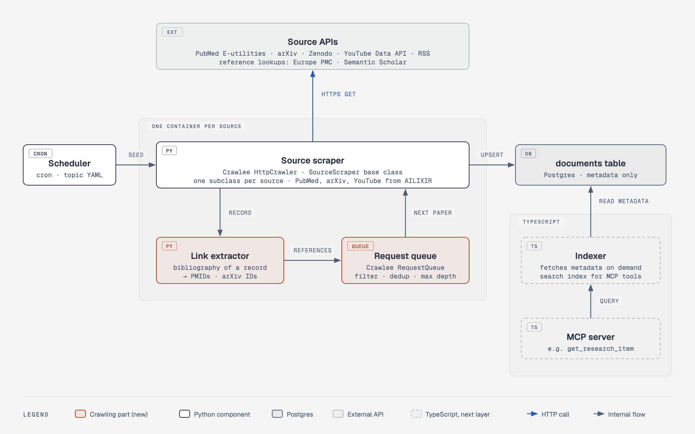

# Crawler evaluation: JValue-Biomed

Sprint 02 · 25 Oct 2026

**Recommendation: reject JValue-Biomed.** We build our own crawler on Crawlee and reuse the PubMed, arXiv and YouTube scrapers from AILIXIR. Only JValue's run log might be worth adding later (see Architecture).

## What JValue does

JValue walks folder trees on FTP servers and records new or changed files in Postgres. It queues their URLs in RabbitMQ. A downloader then saves each whole file to S3 (MinIO), and an XML ingestor turns the files into tables. All of this runs as 13 services on Kubernetes, with Argo starting the jobs.

## Why it doesn't fit

- **Different data.** Our sources are search APIs that return single papers and videos page by page. There are no folders to walk.
- **Full files.** JValue stores every file in full, but we only store metadata.
- **No adapters.** None of our five sources is supported, so we'd write all of them anyway.
- **Heavy to run.** It needs RabbitMQ, MinIO and Kubernetes.

The only crawling we actually need is following the references in a paper's bibliography.

## Why Crawlee

- Its request queue removes duplicates and survives restarts. That's exactly what following references needs: a paper cited twenty times is fetched once.
- It handles retries, rate limits and "too many requests" (429) responses for us.
- Handlers are plain async Python functions, with no framework project structure like Scrapy's.
- If a source ever needs JavaScript rendering, the same code works with its browser crawler.

## Architecture

- **Scheduler:** a daily cron job starts one container per source. A topic file (one per disease area) holds the search queries.
- **Source scraper:** searches the source API and saves the metadata to Postgres. All sources share one base class and one Docker image.
- **Link extractor:** gets each paper's reference list and passes on the papers it cites.
- **Request queue:** decides which cited papers to fetch. It skips papers we already have, skips off-topic papers and stops at a maximum depth.
- **Documents table:** Postgres, metadata only. This is the only interface to the TypeScript side.
- **Indexer and MCP server (TypeScript):** read the metadata from the table when a tool needs it.

**Optional: run log (idea from JValue).** A `crawl_runs` table in Postgres would record each run: source, topic, start and end time, and how far it got. The next run would then only search for what's new since the last successful run. Failed or partial runs would also become visible. Without the run log, each run searches a fixed recent time window, and dedup skips the papers we already have.

**No downloader.** JValue needs one because its crawler only sees file names. Our APIs return the metadata directly, so there's nothing left to download. If a tool needs full text, the TypeScript side fetches it from the stored URL and doesn't keep it.

## Sources

| Source | Code | References from | Rate limit |
|---|---|---|---|
| PubMed | AILIXIR | Europe PMC | 10 requests/s with an API key |
| arXiv | AILIXIR | Semantic Scholar (free key) | 1 request every 3 s |
| YouTube | AILIXIR (official API part only) | none | 10,000 quota units/day |
| Zenodo | new | none (references are free text) | 30 searches/min |
| Podcasts | new | none | about 20 requests/min |

From AILIXIR we take the search queries and the metadata parsing. We drop the PDF downloads, the embedding into AstraDB and the YouTube caption scraping, which goes against YouTube's API policy.

## Constraints

- **Metadata only:** no PDFs, full texts or transcripts are stored.
- **YouTube data expiry:** stored YouTube data must be refreshed or deleted after 30 days.
- **Reference depth:** start with depth 1 (direct references only). Each extra level multiplies the number of requests, because papers cite dozens of others.

## Alternatives we considered

We also tested the other options against our five sources, to make sure we weren't missing a better approach.

| Option | License | Verdict |
|---|---|---|
| JValue-Biomed | — | Reject: built for a different purpose |
| Scrapy | BSD-3-Clause | Would work, but heavier to set up |
| Crawlee for Python | Apache-2.0 | **Use** |
| Old AILIXIR scrapers | MIT | **Reuse** the search and parsing code |

All four returned the same records. The only difference showed when requests failed: the AILIXIR scrapers don't retry, so they lost records under rate limits and server errors. That's why we reuse their parsing code and let Crawlee send the requests.

Beyond that, comparing them told us little. JValue serves a different purpose (bulk files in folder trees), and we mostly query APIs directly, so we don't need a full crawler. Any option that retries failed requests gives the same result for us. The choice comes down to fit and setup effort.
