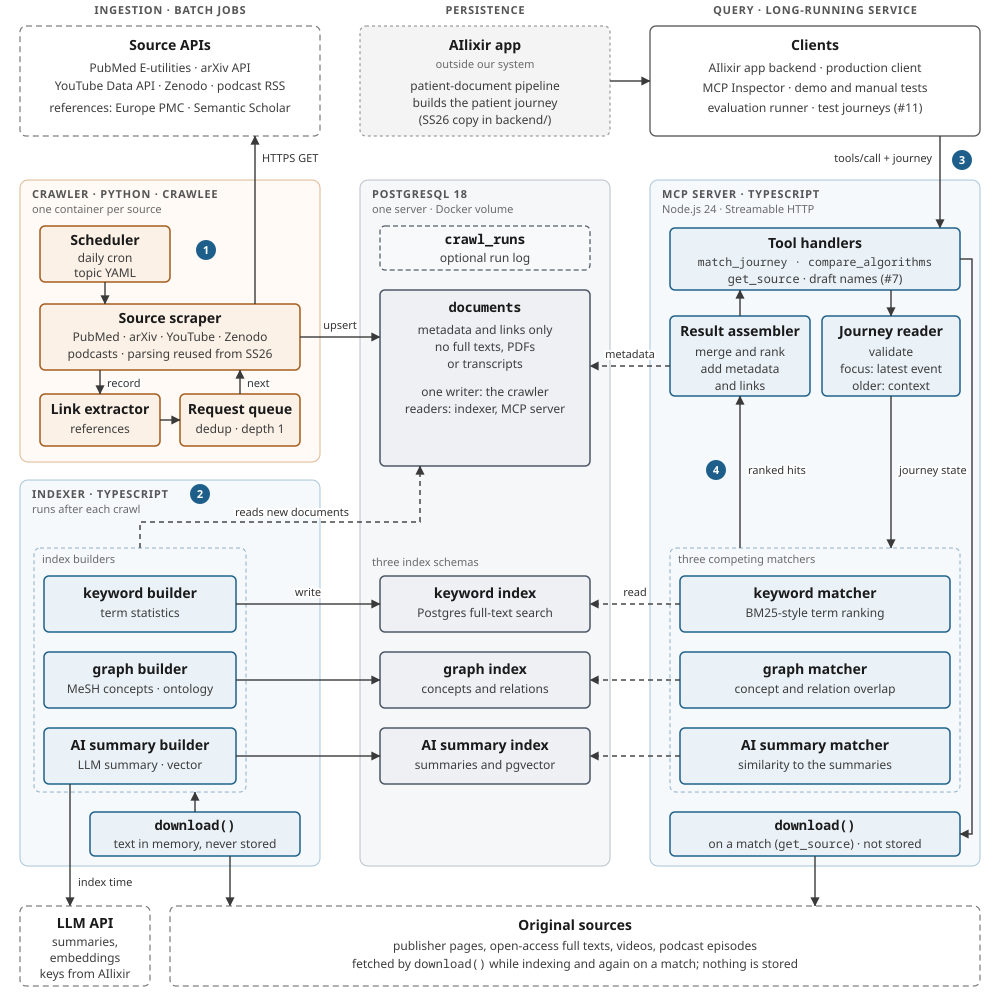
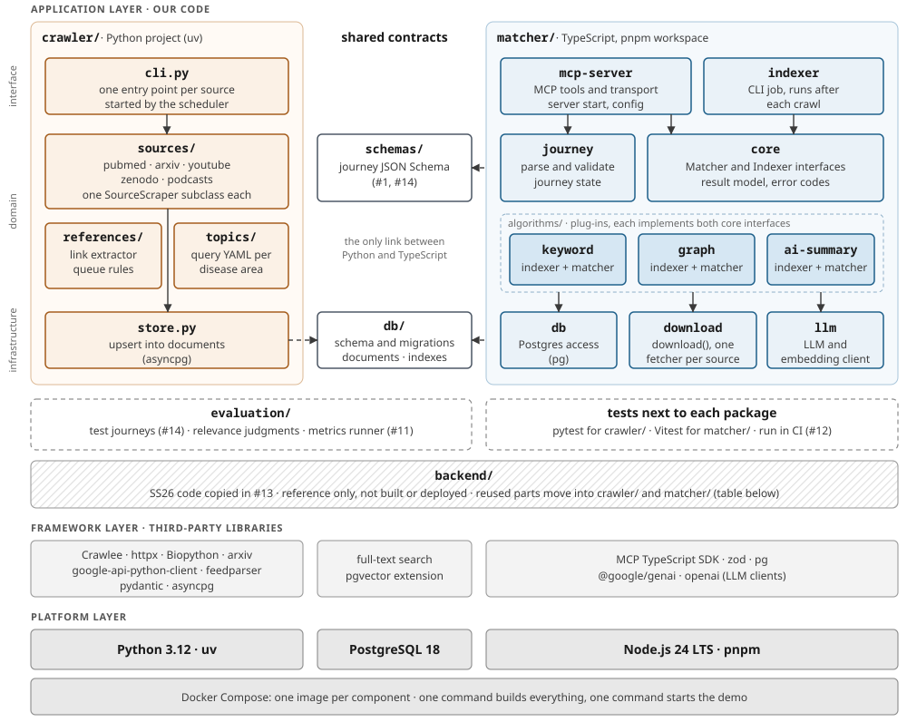

# Software architecture

The Patient Journey Matcher is an MCP server for the AIlixir app. A client sends a patient journey, a dated list of events such as diagnoses and operations, and gets back papers, preprints, videos and podcast episodes that fit the most recent point in that journey.

This page shows the planned design for the mid-project release on 25.11.2026. We will compare it with the real system at the end of the project. The sprint 2 submission of the same content is [`Deliverables/sprint-02/software-architecture.pdf`](../../Deliverables/sprint-02/software-architecture.pdf).

Contents:

1. [Runtime components](#1-runtime-components-tiers)
2. [Code components](#2-code-components-layers)
3. [Technology stack](#3-technology-stack)
4. [Explanation of the diagrams and choices](#4-explanation-of-the-diagrams-and-choices)
5. [Open points](#5-open-points)
6. [Updating this page and the PDF](#6-updating-this-page-and-the-pdf)

## 1 Runtime components (tiers)

What runs and who calls whom. Ingestion runs as scheduled batch jobs, all data is in one PostgreSQL server, and clients talk to one long-running MCP server. The numbered steps are explained in [section 4](#runtime-view).



Legend: orange = Python component, blue = TypeScript component, grey = PostgreSQL table or schema, dashed = external service, dotted grey = outside our system. Solid arrow = call or write, dashed arrow = read.

- Every lane runs as containers from one Docker Compose file: PostgreSQL, one crawler container per source, the indexer job and the MCP server.
- Each table has one writer. The crawler writes `documents`, the indexer writes the three indexes, and the MCP server only reads.
- `download()` is one TypeScript module used by the indexer and the MCP server. Full texts stay in memory and are never written to the database.

## 2 Code components (layers)

How the code in this repository is organised. Each layer only uses the layers below it. Inside our code, interface modules call domain modules, and domain modules call infrastructure modules. The folder names are the planned layout; today the repository holds `crawler/` (empty uv project), `matcher/` (pnpm workspace with empty `indexer` and `mcp-server` packages), `backend/`, `Documentation/` and `Deliverables/`.



Legend: orange = Python module, blue = TypeScript package, darker blue = algorithm plug-in, white = shared contract file, dashed = dev only (not shipped), hatched = reference code. Solid arrow = imports, dashed arrow = follows the contract.

### Where the SS26 code in `backend/` goes

| SS26 code (`backend/…`) | Target | How |
|---|---|---|
| `scrapers/…/PubMed`, `Archive` (arXiv), `YouTube` (official API part) | `crawler/sources/` | Reuse the search and parsing code. Requests go through Crawlee. PDF downloads are dropped; chunking and embedding move to the indexer. |
| `scrapers/…/BaseScraper` (stable IDs, dedup) | `crawler/sources/` base class | Adapt: split fetching and parsing from indexing. |
| `scrapers/key_words/*.csv`, `scrapers/topics.py` | `crawler/topics/` | Reuse as seed queries, converted to one YAML file per disease area. |
| `workers/pipeline/graph/medical_schema.py` | `matcher/algorithms/graph` | Port the entity and relation types to TypeScript. |
| `api/chat_pipeline/paper_retriever.py`, `availability.py`, `astra_client.py`, `reranker_client.py` | `matcher/core`, `download` | Port the result shape, timeouts and the circuit breaker. AstraDB and reranking clients only if we keep those services ([open](#5-open-points)). |
| `workers/connections/gemini_client.py` | `matcher/llm` | Port the pacing and retry conventions. |
| `api/`, `workers/` document pipeline, `shared/` (Firestore, GCS, Pub/Sub) | not in the first release | Stays on the AIlixir side. Reference for a later adapter that builds journeys from patient documents. |

## 3 Technology stack

The first-level technologies we build on, grouped by layer. Versions are the current releases on 27.10.2026. The lockfiles pin exact versions, and the bill of materials in the planning document (#16) is the binding list. Course rule: no copyleft licences in the product.

Basis: **Partner** = project description or AIlixir · **#5** = [crawler evaluation](../../Deliverables/sprint-02/crawler-evaluation.md) · **#13** = [reuse plan](../reuse/what-to-keep.md) · **Proposal** = this document, to be confirmed in review.

| Technology | Version | Used for | Licence | Basis |
|---|---|---|---|---|
| **Languages and runtimes** | | | | |
| Python | 3.12 | Crawler | PSF-2.0 | Partner |
| TypeScript on Node.js | Node 24 LTS | Indexer, matchers, MCP server | Apache-2.0 / MIT | Partner |
| **Crawling (Python)** | | | | |
| Crawlee for Python | 1.11 | Request queue with dedup, retries and rate limits | Apache-2.0 | #5 |
| Biopython (Entrez) | 1.88 | PubMed search and record parsing | Biopython (BSD-style) | #13 |
| arxiv | 4.0 | arXiv API client | MIT | #13 |
| google-api-python-client | 2.201 | YouTube Data API, official API only | Apache-2.0 | #5 |
| feedparser | 6.0 | Podcast RSS feeds | BSD-2-Clause | Proposal |
| pydantic | 2.14 | Validating source records | MIT | #13 |
| asyncpg | 0.32 | Writing to `documents` | Apache-2.0 | Proposal |
| **Storage** | | | | |
| PostgreSQL | 18 | `documents`, run log, three index schemas | PostgreSQL | #5, Proposal |
| Postgres full-text search | built in | Keyword index: term statistics and ranking | PostgreSQL | Proposal |
| pgvector | 0.8 | Vectors for the AI summary index ([AstraDB is open](#5-open-points)) | PostgreSQL | Proposal |
| **Indexing, matching and MCP interface (TypeScript)** | | | | |
| MCP TypeScript SDK v2 (`@modelcontextprotocol/server`, `@modelcontextprotocol/node`) | 2.4 | MCP server over Streamable HTTP | Apache-2.0 | Partner |
| zod | 4.6 | Tool schemas and journey validation | MIT | Proposal |
| pg (node-postgres) | 8.23 | Database access | MIT | Proposal |
| **AI services (hosted, keys from AIlixir)** | | | | |
| Gemini via Vertex AI (`@google/genai`) | SDK 2.31 | Source summaries at index time | Apache-2.0 (SDK) | #13 |
| OpenAI embeddings (`openai`) | SDK 7.45 | Vectors for the AI summary index | Apache-2.0 (SDK) | #13 |
| **Build, test and delivery** | | | | |
| Docker Compose | 5.6 | One command to build, one to start the demo | Apache-2.0 | Proposal |
| uv · pnpm | 0.13 · 12.15 | Dependencies and lockfiles for the bill of materials | MIT / Apache-2.0 · MIT | Proposal |
| pytest · Vitest · Ruff · Biome | 9.1 · 5.0 · 0.17 · 2.6 | Unit tests, linting and formatting | MIT; Biome also Apache-2.0 | Proposal |
| mypy | 2.4 | Python type checks (strict, pydantic plugin) | MIT | Proposal |
| GitHub Actions | service | Tests and lint on every pull request | service terms | Proposal |
| **Demo and test data** | | | | |
| MCP Inspector | 2.12 | Demo client for reviews | MIT / Apache-2.0 | Proposal |
| meddocgenerator (AIlixir) | main | Synthetic patient journeys | Apache-2.0, file headers to clarify | Partner |

### Not used, and why

- **JValue crawler:** built for bulk files in FTP folder trees, supports none of our sources, needs RabbitMQ, MinIO and Kubernetes (#5).
- **Neo4j, Graphiti:** the Neo4j server is GPL-3.0. The patient graph stays with AIlixir; our graph index uses Postgres tables.
- **psycopg:** LGPL-3.0, so we use asyncpg.
- **paperscraper, pypdf, YouTube caption scraping:** we store metadata only, and the caption scraping breaks YouTube's terms.
- **Firebase, Firestore, Cloud Storage, Pub/Sub:** AIlixir app infrastructure, only needed if we take over document upload.

## 4 Explanation of the diagrams and choices

### Runtime view

1. **Crawling.** A daily cron job starts one crawler container per source with the queries from a topic file. The crawler searches the source API, follows a paper's references one level deep, and upserts the metadata into `documents`. It stores metadata and links only, never full texts.
2. **Indexing.** After each crawl, the indexer reads the new documents, fetches each text with `download()`, keeps it in memory, and writes three separate indexes: keyword, graph and AI summary. Only the AI summary builder calls an LLM, and only with public source text.
3. **Query.** A client calls an MCP tool with the journey. The journey reader validates it and builds one journey state: the latest event is the focus, and older events are context. How much older events count is still to be tested (#11). All three matchers get the same state, so their results can be compared fairly.
4. **Answer.** The result assembler merges and ranks the hits and adds the metadata and links from `documents`. When the client asks for one source, `download()` fetches the original again and passes it on without storing it.

### Code view

The layers follow the lecture: platform at the bottom, third-party frameworks on top of it, our application code on top of those. The crawler (Python) and the matcher (TypeScript) share no code. Their only contracts are the database schema in `db/` and the journey JSON Schema in `schemas/`, so both sides can be built and tested on their own. Each algorithm is a plug-in that implements the `Indexer` and `Matcher` interfaces from `core`; a fourth approach would not change the server. `backend/` holds the SS26 code copied in #13. It is not built; the table in section 2 lists where its parts move.

### Choices and reasons

- **Python for crawling, TypeScript for indexing and querying.** Required by the project description. The `documents` table is the interface between the two.
- **Our own crawler on Crawlee instead of a fork of the JValue crawler.** This departs from the project description. Our evaluation (#5) found that JValue walks FTP folder trees and stores whole files, while our sources are search APIs that return single records. The professorship advised us to use JValue only as an architecture reference. Crawlee gives us a deduplicating request queue, retries and rate limits.
- **Metadata only, download on a match.** Storing the originals is too expensive and often not allowed by their licence. The indexes hold derived data only (term statistics, concepts, summaries), and the original is fetched again when needed.
- **PostgreSQL for documents and indexes.** #5 chose Postgres for `documents`. Full-text search and pgvector cover the keyword and AI indexes in the same server, and the graph index fits in two tables for concepts and relations. One database server keeps the demo to one command, and avoids the GPL-3.0 Neo4j server.
- **Three competing algorithms behind one interface.** AIlixir wants a word-statistics, a graph-based and an AI-based approach, each with its own index. We start with the keyword baseline (#8), then add the graph (#10) and AI summary (#9) approaches, and compare all three on the same test journeys and criteria (#11).
- **Selective reuse of the SS26 code (#13).** We keep the PubMed, arXiv and YouTube parsing, the topic lists and the medical ontology, and port the retrieval result shape and the LLM client conventions to TypeScript. We drop chat, voice, OCR and the YouTube caption scraping.
- **Health data.** The server does not store or log the journey. Development uses only synthetic journeys from the AIlixir generator (#14).
- **Docker Compose.** One command builds everything and one starts the demo, on any machine (build process review, 04.11.).

## 5 Open points

To settle with AIlixir and in the team:

- The journey format the real app sends, and the final MCP tool names and fields (#1, #7).
- MCP transport and authentication between the AIlixir backend and our server.
- Vector store: our local pgvector, or AIlixir's AstraDB with Vertex AI Ranking from the SS26 code. The [reuse plan](../reuse/what-to-keep.md) (#13) keeps them, the [crawler evaluation](../../Deliverables/sprint-02/crawler-evaluation.md) (#5) drops the AstraDB embedding.
- LLM provider, EU hosting and who pays; whether summaries and abstracts may be shown to patients.
- Scope of YouTube (stored data must be refreshed or deleted after 30 days) and reference depth beyond one level.
- Production and test system for releases.

## 6 Updating this page and the PDF

This page is the living version. When the architecture changes, update it in the same pull request as the code.

- Diagrams: edit `runtime-components.svg` and `code-components.svg` in this folder. This page and the PDF both use them.
- PDF: the source is `software-architecture.html` in this folder. Regenerate it with

  ```sh
  chromium --headless --no-pdf-header-footer \
    --print-to-pdf=Deliverables/sprint-02/software-architecture.pdf \
    Documentation/architecture/software-architecture.html
  ```

  The sprint 2 PDF is a submitted deliverable. Change it only before the sprint 2 release; later snapshots go into the folder of their sprint.
