# Software architecture

The Patient Journey Matcher is an MCP server. A client sends a patient journey (dated events such as diagnoses and operations) and gets back papers, preprints, videos and podcast episodes that fit the latest event. Data is collected and indexed in nightly batch jobs; a query searches the prepared index.

Contents: [1 Runtime components](#1-runtime-components) · [2 Code components](#2-code-components) · [3 Technology stack](#3-technology-stack) · [4 Explanation of the diagrams and choices](#4-explanation-of-the-diagrams-and-choices). The sprint 2 version of this page is frozen in [`Deliverables/sprint-02/software-architecture.pdf`](../../Deliverables/sprint-02/software-architecture.pdf).

## 1 Runtime components

What runs and who uses whom, read from left to right. The crawler copies metadata from the data sources into PostgreSQL, and the transcription job turns podcast audio without a transcript into text for the indexes. Each matching approach has two parts: an indexer, which the indexer job runs after the crawls to build the approach's index, and a matcher, which the MCP server runs when a client calls `match_journey`. The keyword approach is built. The graph and `ai_summary` approaches are decided and drawn as the research plans them: the graph indexer takes entity and relation annotations of PubMed papers from PubTator3, and both `ai_summary` parts call an AI model service. Notation: UML component diagram; `{…}` says how and when a component runs, a labelled compartment what it offers or holds (MCP tools, schemas, models). The steps are explained in [section 4](#runtime-view).

**Input.** `match_journey` takes the patient as JSON in one of two forms:

- a **journey**: a list of dated events, each with a type (diagnosis, operation, finding …) and a label, as in the `timeline.json` of each synthetic patient in [`patientdata/`](../../patientdata/patientdata.md);
- a **patient graph**: a `Patient` node, nodes for diagnoses, procedures and findings, and dated edges between them, as the SS26 pipeline of the AIlixir app builds it with Graphiti (example: `patientdata/Patient-5/graph.json`).

The server turns a graph into a journey, so today every matcher gets a journey. All fields: [MCP interface](../user/mcp-interface.md).

## 2 Code components

How the code is split into packages, as a UML package diagram. The crawler is one uv project that runs on Crawlee for Python; the matcher is a pnpm workspace of packages named `@matcher/<name>`, and `mcp-server` serves the tools with the MCP TypeScript SDK ([technology stack](#3-technology-stack)). The crawler is shown with its main modules; helpers such as `models` and `http`, and imports of single constants, are left out. The matcher packages form three layers, and between layers the dependencies only point to the right. The interface of an approach, `Approach` with its `Indexer` and `Matcher`, is in `core`; each package in `algorithms/` implements it, and `approaches` creates them and gives the list to the programs.

## 3 Technology stack

Only what the code uses today. Versions are pinned in `crawler/uv.lock` and `matcher/pnpm-lock.yaml`; `scripts/dependencies.py` writes the full list with versions and licences ([build](../build-deploy/build.md)).

| Area | Technology | Used for | Licence |
|---|---|---|---|
| **Crawler** | Python 3.12, uv | Language, dependencies and lockfile | PSF-2.0; MIT or Apache-2.0 |
| | Crawlee for Python | Request queue with deduplication and retries | Apache-2.0 |
| | Biopython (Entrez), arxiv, google-api-python-client | PubMed, arXiv and YouTube Data API clients | Biopython (BSD-style), MIT, Apache-2.0 |
| | requests, python-dotenv, PyYAML, pydantic, py3langid | HTTP, `.env` loading, topic files, record validation, language detection | Apache-2.0, BSD-3-Clause, MIT, MIT, BSD-3-Clause |
| | asyncpg | Writing to PostgreSQL | Apache-2.0 |
| **Storage** | PostgreSQL 18 | Documents, run log and the keyword index; the pgvector extension is installed but unused | PostgreSQL |
| | pg_textsearch | BM25 ranking for the keyword index | PostgreSQL |
| **Matcher** | TypeScript on Node.js 24, pnpm | Language, workspace and lockfile | Apache-2.0, MIT, MIT |
| | MCP TypeScript SDK (`@modelcontextprotocol/server`, `/node`) | MCP server over Streamable HTTP | Apache-2.0 |
| | zod | Tool schemas, journey validation | MIT |
| | pg (node-postgres) | Database access | MIT |
| | htmlparser2, unpdf (pdf.js) | Text of XML, HTML and PDF full texts | MIT; pdf.js Apache-2.0 |
| | pywhispercpp, miniaudio | Offline speech-to-text for podcast audio in the transcription job (`make transcribe`) | MIT |
| **Build and test** | Docker Compose | PostgreSQL and one crawler container per data source | Apache-2.0 |
| | pytest, mypy, Ruff · Vitest, Biome | Tests, type checks, lint and format | MIT; Biome MIT or Apache-2.0 |
| | Make | One command per task: build, test, run ([make targets](../build-deploy/build.md)) | GPL-3.0; a build tool, not part of the product |
| | GitHub Actions | Checks on every pull request | service terms |
| **Development tools** | MCP Inspector | Manual calls to the MCP server | MIT / Apache-2.0 |
| | Debug UI (`debug/crawler/`) | Browse the database, the index and the matcher | MIT (this repository) |
| | graphiti-core, Kuzu, Gemini (in `tools/patient-graph/`) | `make graph`: patient graphs from the synthetic documents | Apache-2.0, MIT, service terms |

## 4 Explanation of the diagrams and choices

### Runtime view

1. **Crawl.** Every night one crawler job per data source (PubMed, arXiv, Zenodo, YouTube, podcasts) runs the queries of the [topic files](../../crawler/README.md#topic-files) against its API and upserts metadata and links into `documents`; each topic is stored as a run of its own in `crawl_runs`, so a stopped crawl loses only its current topic. PubMed records get their full-text links from PMC and OpenAlex. Full texts are never stored. Two crawls started by hand add the papers that the search results cite ([cited papers](../build-deploy/deployment.md#crawl-the-cited-papers)).
2. **Index.** After the crawls, the indexer job reads new or changed documents, downloads their full texts into memory, and runs the indexer of each approach, which writes its own index in PostgreSQL. The texts are discarded afterwards. The keyword indexer builds a BM25 index of the words; the graph indexer will store the entity–relation–entity triples that PubTator3 found in each paper; the `ai_summary` indexer will store a short summary and an embedding of each source.
3. **Transcribe.** The transcription job runs all the time, on idle processor time. It downloads the audio of podcast episodes without a transcript, turns it into text offline with Whisper and hands it to the keyword index, which stores its keywords; the other approaches are to get it too. `make index` and the crawls never wait for it ([speech-to-text](keyword-matching.md#speech-to-text)).
4. **Match.** A client calls `match_journey` with a journey or a patient graph and chooses the approach with `algorithm` (default `keyword`). The server validates the input, takes the latest event as the focus and older events as context, and the matcher of the chosen approach ranks the sources in its index. The graph matcher will compare the patient's relations with the papers' triples; the `ai_summary` matcher will embed the journey, take the nearest sources and can let a language model rerank them.
5. **Fetch.** `get_source` returns the links to a source's files at its origin; the client downloads them itself.

To follow these steps with real data, use the [debug UI](../../debug/crawler/README.md) (`make debug`): one screen per step, from crawler runs and stored documents to the index, the transcription job and each step of a match.

| Component | Runs as | When |
|---|---|---|
| PostgreSQL | Docker container | always |
| Crawler | one Docker container per data source | nightly; the references crawls when started |
| Transcription job | `make transcribe` on the host | always, on idle processor time |
| Indexer | `make index` on the host | after the crawls |
| MCP server | `make start` on the host, Streamable HTTP at `http://127.0.0.1:3000/mcp` | always |

Any MCP client can call the two tools. Today these are the MCP Inspector, the integration tests and the debug UI, when set to go through the server; the AIlixir backend follows with the authentication layer ([choices](#choices)). Server details: [deployment](../build-deploy/deployment.md); tool contract: [MCP interface](../user/mcp-interface.md).

### Code view

- The crawler (Python) and the matcher (TypeScript) share no code. Their contract is the database schema in `db/init/`: the crawler's `store` writes the tables, `db` reads them. Each approach creates the schema of its index itself.
- In the crawler, `cli` starts a run, `runner` drives it with one scraper per data source from `sources`, `links` follows the references of PubMed and arXiv papers, and `store` writes the results.
- Matching approaches are plug-ins. Each package in `algorithms/` implements the `Approach` interface of `core`, with an `Indexer` and a `Matcher`; `approaches` creates one of each, and the programs know the approaches only through that list, so a new approach is one package and one list entry ([adding an approach](../../matcher/algorithms/README.md)). The list holds the [keyword approach](keyword-matching.md); graph and `ai_summary` will be added the same way, under the names the `algorithm` parameter already accepts. Their design follows the research on [graph-based](../../research/graph-based-matching.md) and [AI-based](../../research/ai-based-matching.md) matching.
- The transcriber is drawn like the indexer, serving every approach through `approaches`. Today only keyword has a transcription step, and the transcriber imports it directly.
- In the libraries, `core` holds the interfaces of an approach; `db` connects to PostgreSQL (`createPool`, a pool of reusable connections for `DATABASE_URL`), reads documents (`DocumentStore`) and feeds each index its new and changed documents (`indexChangedDocuments`); `download` downloads full texts and audio (`Downloader`), reads their text (`extractText`) and transcribes audio (`createTranscriber`).
- `evaluation` imports no other package: it reads saved `match_journey` results and scores them against relevance judgments ([matching evaluation](../../research/matching-evaluation.md)).
- [`tools/patient-graph/`](../../tools/patient-graph/README.md) builds patient graphs, the second input form, from the synthetic patients with the graph steps copied from SS26, the AMOS project for AIlixir in the summer semester 2026 (`make graph`). It is a helper tool, not part of the product, and not drawn.

### Choices

- **Python crawler, TypeScript matcher.** Required by the project description; the `documents` table is the interface between the two.
- **Own crawler on Crawlee instead of the JValue crawler.** Our sources are search APIs that return single records; JValue walks file trees ([crawler evaluation](../../Deliverables/sprint-02/crawler-evaluation.md)).
- **Metadata only.** Storing full texts is expensive and often not allowed by their licences. Indexes hold derived data only, and clients fetch the originals themselves.
- **One PostgreSQL server.** Documents and indexes live in one database, with BM25 ranking from pg_textsearch: one service to run and back up.
- **Three approaches behind one interface.** Keyword, graph and `ai_summary` (AIlixir's requirement) answer the same journeys and can be compared on the same test points ([matching evaluation](../../research/matching-evaluation.md)).
- **No copyleft licences in the product** (course rule), for example asyncpg instead of psycopg (LGPL).
- **Health data.** The server does not store or log journeys; development uses only the synthetic patients in [`patientdata/`](../../patientdata/patientdata.md).
- **Authentication layer for AIlixir.** The server accepts only local calls without authentication today; an authentication layer will be added so that the AIlixir backend can use it.
- **Licences for non-commercial use.** The project is non-profit, so sources are used as far as their licences allow non-commercial use ([data sources](sources.md)).

### Editing the diagrams

Sources: [`runtime-view.html`](architecture/runtime-view.html) and [`code-view.html`](architecture/code-view.html), drawn in UML 2.5 notation with the diagram-design skill; export each to the `.svg` next to it with `export_svg.py --system-fonts`. Update this page in the pull request that changes the architecture.
