# Graph matching

The graph approach ranks papers by the medical concepts they share with the patient. It gives the patient, from a patient graph or a timeline, and every paper the same concept IDs, keeps the papers that name one of the patient's diagnoses and ranks them by the other shared concepts and by their fit to the patient's situation. The matcher reads the patient offline and sends nothing about them out; only PubMed IDs go to PubTator3, during indexing. Code: [`matcher/algorithms/graph/`](../../matcher/algorithms/graph/src/); research and results: [graph-based matching](../../research/graph-based-matching.md).



Patient and paper are compared by concept IDs, not by the shape of their graphs. The one relation the ranking compares is `treats`, from a treatment to a diagnosis.

## Try it

After crawling PubMed papers, build the graph index:

```sh
make index APPROACHES=graph
```

In the [debug UI](../../debug/README.md), **Matcher › Graph** with Patient-5 shows the patient query, the candidates and the reasons for each hit. **Index › Graph** shows how a patient graph or a test paper is normalized; so does the command line:

```sh
pnpm --dir matcher --filter @matcher/graph normalize patientdata/Patient-5/graph.json
pnpm --dir matcher --filter @matcher/graph normalize matcher/algorithms/graph/fixtures/pubtator/32343890.json --min-score 0.5
```

A patient concept without an ID: check its spelling or code in the dictionary. An ID but no candidates: check the annotations and MeSH headings of the indexed papers.

## Shared representation

Normalization brings the patient graph and the PubTator3 annotations of a paper into one form: shared IDs, one predicate per relation type and a status for each patient statement ([`types.ts`](../../matcher/algorithms/graph/src/types.ts)).

**Example:** a patient graph and a paper on the same disease and drug, before normalization:

| | Patient graph | PubTator3 annotations of a paper |
|---|---|---|
| Disease | `C61 Prostatakarzinom`, `Adenokarzinom der Prostata` | `Prostatic Neoplasms` (`MESH:D011471`) |
| Treatment | edge `TREATED_BY`, from the disease to the drug | relation `Negative_Correlation`, from the drug to the disease |
| Certainty | `Vd. a. Prostatakarzinom` (suspected), confirmed weeks later | none |

After normalization, both state the same triple:

```
patient:  mesh:C531550 (olaparib)  treats  mesh:D011471 (prostate cancer)   asserted, from 2026-12-08
paper:    mesh:C531550 (olaparib)  treats  mesh:D011471 (prostate cancer)   score 0.998
```

### Entities

IDs are the ones PubTator3 uses: `mesh:` for diseases and chemicals, `ncbigene:` for genes, `dbsnp:` or `hgvs:` for variants. The matcher finds them offline in its own dictionary ([`resolve.ts`](../../matcher/algorithms/graph/src/resolve.ts)), on top of the shared MeSH of [`@matcher/terminology`](../../matcher/terminology/src/) (built by [`build-terminology.py`](../../matcher/terminology/scripts/build-terminology.py)): English and German MeSH names, clinical aliases ([`concepts.json`](../../matcher/algorithms/graph/data/concepts.json)), ICD-10 codes ([`icd10-mesh.json`](../../matcher/terminology/data/icd10-mesh.json) and Mondo mappings) and the names PubTator3 gives the concepts in the index. A patient entity without an ID keeps its name but matches no paper.

Not done, by decision: sending patient names to PubTator3's annotation service, an LLM or an embedding API, which needs a team decision ([rules](../../matcher/algorithms/README.md#rules)); UMLS crosswalks, which need a licence per user. MeSH IDs written by the graph builder would help, but AIlixir owns the builder of the real app.

### Relations

Each edge or relation type becomes one predicate with one direction: the patient's `TREATED_BY` (disease → drug) and PubTator3's `Negative_Correlation` (drug → disease) both become `treats` (drug → disease). The tables are [`patient-relations.json`](../../matcher/algorithms/graph/data/patient-relations.json) and [`pubtator-relations.json`](../../matcher/algorithms/graph/data/pubtator-relations.json); a type without a row becomes `related`. Providers, appointments, referrals and vital signs are left out.

### Status

Each patient statement is `asserted`, `suspected`, `negated`, `planned` or `unknown` at its date. Cue words in the fact sentence decide first (`Verdacht auf` → suspected, `ausgeschlossen` → negated, `confirmed` → asserted), then a treatment plan (planned), then the node's own status from its confirmation date on, because Graphiti rewrites a node with every document ([`status.ts`](../../matcher/algorithms/graph/src/status.ts), [`status-cues.json`](../../matcher/algorithms/graph/data/status-cues.json)). The matcher reads the statements valid on `as_of`: suspected, planned and unknown ones count less than asserted ones, negated ones not at all.

## Ranking

Steps 1 and 2 are one SQL query ([`retrieval.ts`](../../matcher/algorithms/graph/src/retrieval.ts)) over the tables of the [graph index](storage.md#graph-index). Step 3 runs in the matcher on the best papers only, because its rules need the matcher's dictionaries ([`rerank.ts`](../../matcher/algorithms/graph/src/rerank.ts)).

1. **Candidates:** the papers whose PubTator3 concepts or MeSH headings name one of the patient's diagnoses, or a narrower form such as castration-resistant prostate cancer. A general word such as tumor or carcinoma is no diagnosis of its own. Without a diagnosis there are no hits. For a diagnosis that very many papers name, only the newest of them are candidates (`pool`).
2. **Score:** the sum of evidence × IDF × weight over the patient's concepts that the paper has; each concept counts once.
   - **Evidence:** the concept's strongest mention in the paper: title or MeSH major topic, then the substance list, another MeSH heading, the abstract alone.
   - **IDF** (inverse document frequency, as in BM25): how rare the concept is among the candidates of this query. A concept that nearly every candidate has, such as the diagnosis, hardly tells them apart; a rare one, such as a specific drug, does. Diagnoses keep an IDF of at least 1, so their title and major-topic evidence still counts; prostate cancer, whose constants were tuned without this floor, is the exception.
   - **Weight:** the concept's role (a drug or procedure counts more than a finding) × the certainty of its status × focus: the news of the focus day and the current therapy count more.
3. **Re-rank:** the matcher scores the best papers (`candidates`; on a tie the newer paper) again with what the SQL query cannot check, and explains each hit by its main reasons:
   - concepts in the title count, also procedures, which PubTator3 does not annotate;
   - a paper that links the patient's drug to the patient's diagnosis gains; one that links it only to another disease does not count the drug;
   - a paper on the patient's disease state, such as metastatic or castration-resistant, gains; one on another state or phase of care loses;
   - a paper mainly about something else loses: the diagnosis only in its abstract, lab or animal research, the other sex, another cancer or histology, and for a patient without cancer another disease, which costs less than another cancer;
   - guidelines and reviews gain a little, case reports lose a little.

The rules of one disease live in its disease profile ([`profile.ts`](../../matcher/algorithms/graph/src/profile.ts)): how a journey shows the disease without naming it, such as PSA, PI-RADS and Gleason for prostate cancer, its own disease states, the MeSH topics that tell a paper on treating the disease from one on finding it, its treatment options and its care questions. Its data is in [`data/profiles/`](../../matcher/algorithms/graph/data/profiles/), the rest in [`src/profiles/`](../../matcher/algorithms/graph/src/profiles/). The rules for reading a journey apply to every journey, because they find the disease; the others apply to a patient with the disease and to the papers on it. Prostate cancer has the only profile. A new disease is one more profile in `PROFILES`, without changes to the general code.

The constants are `SETTINGS` in [`settings.ts`](../../matcher/algorithms/graph/src/settings.ts); in the debug UI, a `tuning` object overrides them. How they were set and what they achieve: [results](../../research/graph-based-matching.md#7-results).

## Known limitations

- **`treats` is no proof of effect:** PubTator3's relation means that the paper links the drug and the disease, not that the drug works. It has no negation, evidence sentence or date.
- **Gaps in PubTator3:** it annotates no procedures and misses some drugs, such as leuprorelin, goserelin and the class PARP inhibitor; only MeSH headings or the title find them. It often annotates PSA as the wrong gene.
- **The candidate gate:** a paper that names the diagnosis neither in its annotations nor in its MeSH headings is never a candidate, even with a relevant title.
- **The shortlist:** the re-rank sees only the best papers by score. A paper whose fit shows only there, such as a procedure in its title, can be cut before (`candidates` in `SETTINGS`).
- **Status comes from rules** over sentences that an LLM has already rewritten: a hedge it dropped is lost. Past conditions ("history of", "Z. n.") have no status yet.
- **One disease profile:** only prostate cancer has rules of its own ([Ranking](#ranking)). Other cancers get the states every cancer has, other diseases the general rules.
- **Vocabulary:** some clinical German names and some operations have no MeSH name; ICD-10 mappings outside the reviewed cancer categories are partial.
- **Sources:** only PubMed papers have PubTator3 annotations; other sources match through their MeSH headings only.
