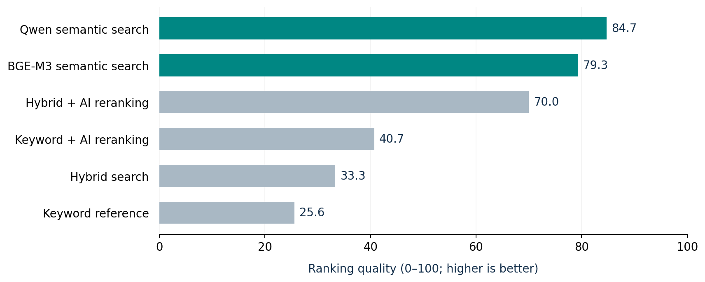

# AI matching: what worked best?

17 November 2026 · Exploratory results on synthetic data

## Recommendation

**Use semantic search as the starting point for the next evaluation.** Qwen had
the highest observed matching quality. BGE-M3 was faster and is a strong
alternative; this small study did not establish a clear quality difference
between the two models.

Semantic search compares the meaning of a journey with the meaning of a resource.
This was useful when the journey was in German and the resource was in English.

| Approach | Exact model(s) or method | Ranking quality¹ | Response time² |
|---|---|---:|---:|
| Qwen semantic search | Qwen/Qwen3-Embedding-0.6B | 84.7 | 0.24 s |
| BGE-M3 semantic search | BAAI/bge-m3 (dense mode) | 79.3 | 0.08 s |
| Hybrid + AI reranking | BM25 + Qwen/Qwen3-Embedding-0.6B + Qwen/Qwen3-Reranker-0.6B | 70.0 | 8.05 s |
| Keyword + AI reranking | BM25 + Qwen/Qwen3-Reranker-0.6B | 40.7 | 7.42 s |
| Hybrid search | BM25 + Qwen/Qwen3-Embedding-0.6B | 33.3 | 0.24 s |
| Keyword reference | BM25Okapi keyword search; no AI model | 25.6 | <0.01 s |

¹ Ranking quality is nDCG@10 scaled to 0–100, **not an accuracy percentage**.
² Time within which 95% of warm requests completed on an Apple M1 with 8 GB memory.
Hybrid + reranking time is a sum of separately measured stages, excluding model loading.

### How the combinations worked

Keyword + reranking first retrieved up to 50 resources using BM25, then reordered
them with **Qwen/Qwen3-Reranker-0.6B**. Hybrid search combined BM25 results with
**Qwen/Qwen3-Embedding-0.6B** results using equal rank weights and kept 50 candidates.
Hybrid + reranking added the same Qwen reranker after that combination. The BGE-M3
model was used only in its standalone semantic-search comparison.

Embedding models processed both the journey query and resource text (title,
abstract and subjects). The Qwen embedding model, Qwen reranker and Qwen text
generator are three separate checkpoints with different jobs.

## Why semantic search is the better starting point here

- **It handled the language mismatch better.** With paired English queries, the
  keyword reference scored 93.0 and Qwen scored 91.7. This suggests language
  bridging explains much of the German-query advantage. The synthetic English
  queries also reuse wording from the resources, making that control easier.
- **Reranking added cost without beating semantic search.** It improved the
  keyword results, but could not recover relevant resources missing from the
  initial shortlist. The hybrid reranker had broader coverage, yet remained
  slower and scored below either standalone embedding model.
- **Combining methods was not automatically better.** The tested hybrid gave the
  weak keyword ranking equal influence, which likely contributed to its poor
  ordering. Other combinations or weights were not evaluated.

## What about AI summaries?

The separate text-generation model **Qwen/Qwen3-0.6B** was unreliable in this readiness check: only
5 of 16 primary outputs passed the format and exact source-quote checks.
Unsupported comparison and outcome statements were also observed. Passing those
checks does not establish factual correctness. Larger summarizers and the effect
of summaries on ranking were not tested. Existing titles and abstracts are the
simpler starting point for now.

## How far can we trust the result?

The comparison used real local models, 120 synthetic resources and 24 development
queries from a 40-query dataset. Labels are drafts, some examples reuse authoring
patterns, and independent review and fresh-query validation remain pending.
The results support a direction for further testing, not a confirmed winner for
real patients.

The keyword reference was simpler than the project's existing matcher, which
already maps German medical terms and emphasizes the current journey event.
**This study does not establish an improvement over the current application.**

Models: [Qwen3-Embedding-0.6B](https://huggingface.co/Qwen/Qwen3-Embedding-0.6B),
[BGE-M3](https://huggingface.co/BAAI/bge-m3),
[Qwen3-Reranker-0.6B](https://huggingface.co/Qwen/Qwen3-Reranker-0.6B).

[Simple PDF](ai-matching-report.pdf) · [Detailed PDF](detailed/ai-matching-report-detailed.pdf) · [Exact model reference](models-used.md).
