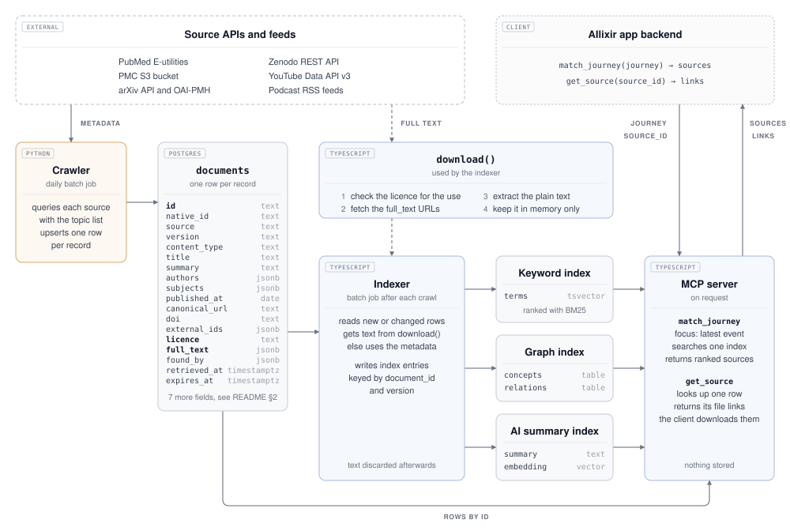
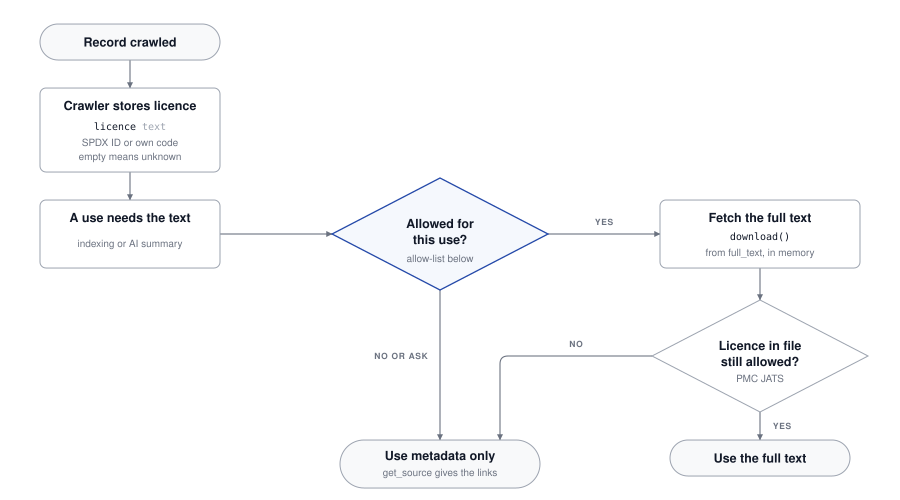

# External sources: metadata, storage and indexing

Findings for #6, checked 01.11.2026 against live docs and live requests. Follows the [architecture](../architecture/README.md): the crawler stores metadata and links only; the indexer and the MCP server fetch full texts in memory and never store them. Summary: [`pipeline-overview.pdf`](pipeline-overview.pdf). Open questions: [`open-questions.md`](open-questions.md).

## 1 Sources at a glance

| Source | Role | Page | Offers | Full source for the indexer | Existing connector |
|---|---|---|---|---|---|
| PubMed | primary | [`pubmed.md`](pubmed.md) | 41.4 M citations, abstracts, MeSH | Via PMC if there is a PMCID | SS26, #27 |
| PMC | primary | [`pmc.md`](pmc.md) | About 8 M full-text article versions on S3 | JATS XML | crawler |
| arXiv | secondary | [`arxiv.md`](arxiv.md) | Preprints, about 8,300 a year in medical categories | HTML, else PDF | SS26, #27 |
| Zenodo | secondary | [`zenodo.md`](zenodo.md) | Any research output, no review | Files: PDF, DOCX, PPTX, MP4 | crawler |
| YouTube | complementary | [`youtube.md`](youtube.md) | Metadata of curated channels | None: description and chapters only | SS26, #27 |
| Podcasts | complementary | [`podcasts.md`](podcasts.md) | Curated RSS feeds | Transcript file (rare), else show notes | crawler |

Primary: peer-reviewed core. Secondary: preprints and grey literature. Complementary: curated formats for patients.

## 2 Metadata schema

Table `documents`, one row per source record. PMC has no rows; it fills the PubMed row. Field paths per source: source pages. Independent of the #27 draft model.

| Field | Type | Req. | Meaning |
|---|---|---|---|
| `id` | text | yes | `<source>:<native_id>`, primary key, stable across versions; the MCP `source_id` |
| `source` | text | yes | `pubmed`, `arxiv`, `zenodo`, `youtube`, `podcast` |
| `native_id` | text | yes | ID in the source, no version suffix |
| `version` | text | | Version the row describes |
| `content_type` | text | yes | `journal_article`, `preprint`, `conference_paper`, `poster`, `presentation`, `report`, `book`, `video`, `podcast_episode` |
| `publication_types` | text[] | | Source labels, e.g. PubMed `Review` |
| `title` | text | yes | Plain text |
| `authors` | jsonb | yes | `[{name, orcid, affiliation}]`; channel or host for media |
| `venue` | text | | Journal, channel or show |
| `summary` | text | | Abstract or description; show notes cut to 1,000 characters |
| `language` | text | | BCP 47 |
| `subjects` | jsonb | | `[{scheme, id, label, major}]`, e.g. MeSH |
| `published_at` | date | yes | First public date |
| `published_precision` | text | yes | `year`, `month` or `day` |
| `source_updated_at` | timestamptz | | Last change reported by the source |
| `duration_seconds` | integer | | Videos and episodes |
| `canonical_url` | text | yes | Page shown to users |
| `doi` | text | | Lower case, no `https://doi.org/` |
| `external_ids` | jsonb | | e.g. `pmcid`, `pmc_version`, `nihms`, `concept_doi`, `channel_id`, `feed_key` |
| `licence` | text | | SPDX ID, PMC's CC code without version (`CC-BY-NC`), or own code (`arxiv-nonexclusive-1.0`, `pmc-tdm`, `youtube-standard`, `all-rights-reserved`); empty = unknown |
| `full_text` | jsonb | | Locators in fetch order: `[{kind, url, media_type, size, checksum}]` |
| `found_by` | jsonb | yes | `[{topic, query}]` or `[{cited_by: <id>}]` |
| `retrieved_at` | timestamptz | yes | Last successful fetch |
| `expires_at` | timestamptz | | YouTube only: `retrieved_at` + 30 days |
| `extra` | jsonb | | Source-specific fields, see source pages |

Implemented in [`db/init/02-documents.sql`](../../db/init/02-documents.sql) (#41), with `created_at` and `changed_at` added and `published_at`/`published_precision` optional: [storage and retrieval](../storage.md).

## 3 Indexing

The indexer (and `get_source`) checks `licence` against the allow-list for the use, tries the `full_text` locators in order and keeps the text in memory. Not allowed: title, summary and subjects from the row only.

Why at use time, not in the crawler:

- The licence covers the full text, not the metadata (arXiv and Zenodo metadata is CC0, PubMed under NLM terms). Every record stays findable and linkable.
- Most records have no licence when crawled: PubMed without a PMCID, all podcasts.
- Each licence has three permissions, and open or future decisions (commercial use) change them. A new allow-list means re-indexing, not re-crawling. The crawler filters only for relevance.

Allow-list proposal for the current non-commercial university project (not legal advice):

| Licence | Keyword, graph, AI index | AI summary shown | MCP passes the original on | If used commercially later |
|---|---|---|---|---|
| CC0, CC BY, public domain | yes | yes, with credit | yes, with credit | same |
| CC BY-SA, CC BY-ND | yes | ask | SA: same licence; ND: unchanged | same |
| NC licences | yes | as without NC | as without NC | no |
| PMC `TDM`, arXiv default | yes (text mining, research use) | ask | no, link only | ask |
| All rights reserved, unknown | ask | no | no, link only | ask |

Licences differ per record: PMC mixes CC BY and NC in one bucket; 8 % of a Zenodo and 16 % of an arXiv sample are NC; a third of medical arXiv papers carry only arXiv's licence; no podcast feed grants one.

## 4 MCP server

Per the proposal on `feature/7-mcp-interface` (#7). Reads `documents` and the indexes, writes nothing.

- `match_journey`: index rows carry `document_id`, so each hit resolves to its row.
- `get_source(source_id)`: `source_id` = `documents.id`. Calls `download()` with the "passes the original on" column and the stored `version`. Not allowed: abstract or description plus link. Deleted row (e.g. YouTube after 30 days): `SOURCE_NOT_FOUND`. Shares the request budgets with the indexer.
- Field mapping: `id` → `source_id`; `canonical_url` → `url`; `published_at` + `published_precision` → `published_date` (`2026`, `2026-09`, `2026-09-13`); `authors[].name` → `authors`; `source`, `title`, `content_type`, `licence` unchanged.
- Needed in #7, not made here:
  1. Add `content_kind: description` (Zenodo, YouTube, show notes). Keep `abstract`; `summary` would clash with the AI summary approach.
  2. Document the fallback: abstract or description plus `url`, not an error.

## 5 Storage, limits and retention

- **Stored:** the `documents` row and index rows only. Never full texts, PDFs, audio, video or transcripts. ASCO show notes contain transcripts, so the crawler cuts them.
- **Index rows** carry `document_id`, `version` and `document_changed_at`; deleted with the document, rebuilt when the row changes ([storage](../storage.md)).
- **Crawler state** (not in `documents`): curated lists (topics, channels, [feeds](podcasts.md#curated-feed-list)); per feed URL, `ETag`, `Last-Modified`, last status; per channel the uploads playlist ID.
- **Retention:** YouTube data, IDs included, refreshed or deleted within 30 days (III.E.4.d); gone videos deleted with their index rows; no view counts, never in a score (III.E.4.h). PubMed kept current or flagged as possibly outdated. No limit elsewhere. Each store run deletes rows past `expires_at` ([storage](../storage.md)).
- **New since last run:** PubMed `datetype=edat`; arXiv `submittedDate` (`lastUpdatedDate` silently acts as `submittedDate`); Zenodo `updated:[… TO *]`; YouTube uploads playlist to `videoPublishedAt`; podcasts conditional GET.
- **Caps per query:** PubMed 9,999, Zenodo 10,000, arXiv 30,000; split by date.
- **Identification:** User-Agent with app, version, repo URL, team contact. NCBI also `tool` and `email`. Zenodo may block generic agents.
- **Attribution:** name NLM; arXiv line "Thank you to arXiv for use of its open access interoperability."; credit CC BY; label YouTube items with unchanged title, thumbnail, channel; no NLM, PMC or arXiv logos.

Request budgets, shared per key or host by crawler, indexer and MCP server:

| Budget | Limit | Used by |
|---|---|---|
| NCBI E-utilities | 10 req/s per key (3 without), 429 above | PubMed crawler, reference crawl, indexer, MCP |
| arXiv API + OAI-PMH | 1 req per 3 s, one connection | arXiv crawler incl. one licence lookup per paper |
| arxiv.org pages | `Crawl-delay: 15` | Indexer, MCP |
| Zenodo | 30 searches/min (also with token); 133 record/file req/min | Crawler, indexer |
| YouTube | 10,000 units/day + 100 `search.list`/day | Crawler, refresh job (< 100 units/day) |
| Semantic Scholar | 1 req/s with key | arXiv reference crawl |
| PMC S3, podcast hosts | none published | Indexer; one conditional GET per feed and day |

## 6 Traceability

- `id`, `native_id`, `version`, `canonical_url`, `doi`, `external_ids` identify the source; `found_by`, `retrieved_at` say how and when it came in.
- IDs are stable across versions (arXiv without `vN`, Zenodo concept ID).
- Duplicates are linked, not merged: grouped at query time by DOI, then PMCID or PMID, then title hash. Zenodo copies match only via `related_identifiers` or title hash.
- YouTube is never merged with other data; each item is labelled as YouTube.

## 7 Changes needed in the existing documents

Not made in this issue:

- **Architecture §4 Indexing:** "public source text" → "text whose licence is on the allow-list".
- **Architecture §4 Answer:** `download()` passes the original on only where the licence allows; otherwise abstract or description plus link.
- **Architecture §4, crawler evaluation:** PMC S3 is the full-text path for PubMed (OA web service, FTP packages and licence folders retired 08.2026).
- **Architecture §3:** indexer needs a PDF text extractor (not chosen). `arxiv` 4.0.2, `feedparser` 6.0.14; feedparser misses `podcast:*` tags.
- **Architecture §5:** YouTube 30-day rule covers IDs and playlist IDs; add labelling and the popularity-score ban.
- **Crawler evaluation:** YouTube search has its own 100 calls/day (since 01.06.2026); PubMed `elink` gives cited PMIDs, so Europe PMC may be unnecessary; Zenodo's 30/min also applies with a token; arXiv OAI-PMH is at `oaipmh.arxiv.org` (03.2025); podcasts' 20 req/min is our own limit.
