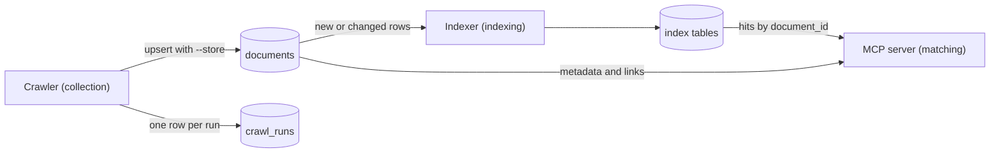

# Resource storage and retrieval

The crawler stores what it collects in PostgreSQL (#41); the indexer and the MCP server read it from there. Local setup: [database.md](database.md).



| Table | Written by | Read by |
|---|---|---|
| `documents` | crawler | indexer, MCP server |
| `crawl_runs` | crawler | crawler (`--since auto`), people |
| index tables, e.g. `keyword.documents` and `keyword.full_texts` ([keyword matching](keyword-matching.md)) | indexer | MCP server |

## Storing

```sh
cd crawler
uv run crawler pubmed --topic prostate_cancer --store
```

`--store` needs `DATABASE_URL` (see [`crawler/.env.example`](../crawler/.env.example)) and the schema (`make db`); the crawler checks both before the crawl and exits with 2 if one is missing. Cited papers that are already stored are not fetched again. The JSON Lines on stdout stay the same. After the crawl, a YouTube run refreshes the stored videos of its channels that expire within 15 days. Then one transaction:

1. upserts each document, refreshed videos included, by `id`: columns get the new values, `found_by` gains the new entries, `changed_at` moves only if the content changed;
2. adds the run's `cited_by` entries to stored documents it did not fetch again;
3. deletes rows whose `expires_at` has passed (YouTube: 30 days after retrieval);
4. writes the run to `crawl_runs`.

If storing fails, nothing of the run is stored, `storing failed` goes to stderr and the exit code is 1.

## Schema

[`db/init/02-documents.sql`](../db/init/02-documents.sql) and [`03-crawl-runs.sql`](../db/init/03-crawl-runs.sql). `documents` follows [sources §2](sources/README.md#2-metadata-schema), except:

- `created_at`, and `changed_at`: last change of any column but `found_by`, `retrieved_at` and `expires_at`.
- `published_at` and `published_precision` may be empty; some records have no valid date.
- Lists and objects are `[]` or `{}`, never null.

From the crawler's `SourceDocument`: `source_id` → `native_id`, `journal` → `venue`, `abstract` (else `description`) → `summary`, `url` → `canonical_url`, `published_on` → `published_at`, `refresh_after` → `expires_at`, `channel_id` → `external_ids`.

## Languages

The crawler detects the language of each document's title and summary offline with [py3langid](https://github.com/adbar/py3langid) ([`crawler/src/crawler/language.py`](../crawler/src/crawler/language.py)) and stores it as `extra.metadata_language` (BCP 47, e.g. `en`). A source's `language` can name something else: PubMed gives the article's language, and a German article often has an English abstract. So `language` keeps the source's value and only gets the detected one where the source gave none.

- Missing `metadata_language` means unknown, not "not English": short titles such as `PSA` are too short to tell, and stored cited papers keep their old row until a run fetches them again. An indexer that skips non-English metadata should treat unknown as matchable.
- Non-English documents are stored like the others, so they stay findable and their citations stay complete.
- The first store run after this change counts every document it fetches again as changed, once, since `extra` and `language` are content: the indexers read their full texts again.

## Reading

The schema is the only contract between the crawler (Python) and the matcher (TypeScript). The matcher reads through [`@matcher/db`](../matcher/db/src/documents.ts), which treats rows past `expires_at` as gone:

```ts
import { createDocumentStore, createPool } from "@matcher/db";

const store = createDocumentStore(createPool()); // DATABASE_URL, as for the crawler
const hits = await store.getDocuments(ids); // in the order of ids, e.g. ranked index hits
const next = await store.documentsToIndex("keyword_index", 500);
```

`toSourceReference` in [`mcp-server/src/sources.ts`](../matcher/mcp-server/src/sources.ts) turns a document into the fields of a tool result ([sources §4](sources/README.md#4-mcp-server)).

Index tables reference their document, so deleting it removes them, and keep the `changed_at` they indexed (as read, in milliseconds). `documentsToIndex` returns the documents without a row or with a different `changed_at`, and `countToIndex` counts them; polling `changed_at > last run` instead would miss the rows of a store run that commits late.

```sql
CREATE TABLE keyword_index (
    document_id text PRIMARY KEY REFERENCES documents (id) ON DELETE CASCADE,
    version text,
    document_changed_at timestamptz NOT NULL
    -- index data
);
```

Duplicates are grouped by `doi` at query time; the last run per source is `SELECT DISTINCT ON (source) * FROM crawl_runs ORDER BY source, finished_at DESC`.

## Limits

- Expired rows are deleted by the next store run. YouTube rows stay while their channels are crawled with `--store` at least every two weeks and the videos stay public.
- Stored cited papers are not refreshed; search results are.
- YouTube rows have no `venue`, and a few rows have no `title` (shown as `Untitled`).

## Schema changes

`db/init/` runs when an empty volume starts; `make db` applies it again, so the files must stay idempotent. Put a change into a new numbered file, e.g. `04-….sql` with `ALTER TABLE … ADD COLUMN IF NOT EXISTS`.
