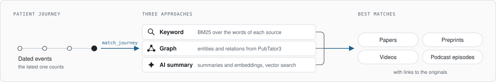

<p align="center">
  
</p>

<h1 align="center">Patient Journey Matcher (AMOS WS 2026)</h1>

<p align="center">
  <a href="https://github.com/amosproj/amos2026ws03-patient-journey-matcher/actions/workflows/ci.yml"></a>
  <a href="LICENSE"></a>
</p>

The Patient Journey Matcher is an MCP server for the AIlixir app. A client sends a patient journey, a dated list of events such as diagnoses and operations, and gets back research papers, preprints, YouTube videos and podcast episodes that fit the latest event in that journey.



- **Crawler (Python):** collects metadata and links from PubMed, arXiv, Zenodo, YouTube and podcast feeds and stores them in PostgreSQL, never the full texts.
- **Indexer (TypeScript):** builds the [keyword index](Documentation/design/keyword-matching.md) from document text, the [graph index](Documentation/design/graph-normalization.md) from PubTator3 annotations and, if enabled, the index of [semantic matching](matcher/README.md#semantic-matching).
- **MCP server (TypeScript):** matches the journey against the index and returns the best sources with links to the originals.

How it fits together: [software architecture](Documentation/design/architecture.md). To watch it work with real data, use the [debug UI](#explore-the-pipeline).

## Tech stack

- **Crawler:**    
- **Indexer and MCP server:**     
- **Database:**   
- **Checks:**      

All libraries, what they are used for and their licences: [technology stack](Documentation/design/architecture.md#3-technology-stack).

## Getting started

**Prerequisites:** [Git](https://git-scm.com/downloads), [Docker](https://docs.docker.com/get-docker/) with Compose, [uv](https://docs.astral.sh/uv/getting-started/installation/) 0.13 or newer, [Node.js](https://nodejs.org/en/download) 24 LTS, [pnpm](https://pnpm.io/installation) 12 (pinned in `matcher/package.json`) and [Make](https://www.gnu.org/software/make/).

```sh
cp .env.example .env   # choose your own POSTGRES_PASSWORD
make db                # PostgreSQL in Docker, with the tables from db/init/
make seed              # a small sample crawl of every source
make index             # installs the dependencies and builds the index of each approach
make start             # MCP server on http://127.0.0.1:3000/mcp
```

Then call it with the MCP Inspector: [try it](Documentation/user/mcp-interface.md#try-it). The API keys of the data sources go into `crawler/.env` and are optional; without `YOUTUBE_API_KEY`, the sample crawl skips YouTube ([crawler](crawler/README.md)).

Podcast audio without a transcript: `WHISPER_MODEL=tiny-q5_1 make transcribe WORKERS=2` transcribes it, two files at a time, until you stop it; the next `make index` reads the text.

### Explore the pipeline

For semantic matching, run `make index-ai` once, then `make debug-ai` to start the encoder, MCP server and debug UI together ([settings](matcher/README.md#semantic-matching)).

`make debug` starts the [debug UI](debug/README.md) on http://127.0.0.1:8765: one screen per step, from crawler runs and stored documents to the index and each step of a match (search terms per event, the rank of each hit in both indexes, the rank fusion), plus the machine and its timers.

## Development

```sh
make build              # installs crawler/ with uv and matcher/ with pnpm, type-checks matcher/
make test               # the crawler and matcher checks of CI: lint, formatting, types, unit and integration tests
make test-integration   # only the matcher's integration tests
```

Single checks, run in the project's folder:

| Check | `crawler/` | `matcher/` |
|---|---|---|
| Lint | `uv run ruff check .` | `pnpm lint` |
| Fix formatting | `uv run ruff format .` | `pnpm exec biome check --write .` |
| Types | `uv run mypy src` | `pnpm typecheck` |
| Tests | `uv run pytest` | `pnpm test` |

- Database tests run only with `TEST_DATABASE_URL`; `make` sets it from the root `.env`.
- Commit `crawler/uv.lock` and `matcher/pnpm-lock.yaml` with every dependency change.
- All make targets, the end-to-end tests, CI and the SBOM: [build, run and test](Documentation/build-deploy/build.md).

## Documentation

- **User:** [MCP interface](Documentation/user/mcp-interface.md), [synthetic patients](patientdata/patientdata.md), [patient graph tool](tools/patient-graph/README.md), [debug UI](debug/README.md)
- **Design:** [software architecture](Documentation/design/architecture.md), [data sources](Documentation/design/sources.md), [storage](Documentation/design/storage.md), [keyword matching](Documentation/design/keyword-matching.md)
- **Build and deploy:** [build, run and test](Documentation/build-deploy/build.md), [local database](Documentation/build-deploy/database.md), [deployment](Documentation/build-deploy/deployment.md)
- **Research:** [the team's investigations](research/README.md)

Index of all pages and the [glossary](Documentation/glossary.md): [Documentation](Documentation/README.md).

## Repository

| Folder | Content |
|---|---|
| `crawler/` | Python crawler ([README](crawler/README.md)) |
| `matcher/` | TypeScript pnpm workspace: MCP server, indexer, transcription job, approaches and shared packages ([README](matcher/README.md)) |
| `db/` | PostgreSQL image and schema |
| `deploy/` | Setup and backup scripts of the VM ([deployment](Documentation/build-deploy/deployment.md)) |
| `debug/` | [Debug UI](debug/README.md) for the crawler, the database, the index and the matcher |
| `scripts/` | Sample crawl, coverage report, speech-to-text, SBOM |
| `patientdata/` | [Synthetic patients](patientdata/patientdata.md) for development and tests |
| `tools/patient-graph/` | Helper tool that builds patient graphs, the second matching input, from the synthetic patients; code from SS26 ([README](tools/patient-graph/README.md)) |
| `Documentation/` | User, design, and build and deploy documentation |
| `research/` | The team's investigations ([index](research/README.md)) |
| `Deliverables/` | Sprint deliverables, frozen |

## Licence

MIT, see [LICENSE](LICENSE). The code copied from SS26 is listed in [NOTICE](NOTICE).
