# Data sources: research

The API research of #6 (2026-11) and later coverage measurements. What the crawler implements is in [data sources](../../Documentation/design/sources.md); where a page here differs from the code, the code is right.

Pages per source: [PubMed](pubmed.md) · [PMC](pmc.md) · [OpenAlex](openalex.md) · [arXiv](arxiv.md) · [Zenodo](zenodo.md) · [YouTube](youtube.md) · [podcasts](podcasts.md). Summary of #6 as a PDF: [`pipeline-overview.pdf`](../snapshots/pipeline-overview.pdf) (snapshot).

## Coverage

To measure a stored crawl: `make index APPROACHES=keyword`, then `cd crawler && uv run python ../scripts/coverage.py` against the same `DATABASE_URL`. The read-only JSON report separates links, downloaded and read texts, indexed texts, pending records and failures; the `*_without_openalex` columns compare against the same dataset without OpenAlex. Pending records mean that indexing is not finished.

### Seed crawl, 2026-11-11 (#57)

The crawls of [`scripts/seed.py`](../../scripts/seed.py) (`make seed`), from `main` before #57 and with #57, both on 2026-11-11. YouTube is left out on both sides (no API key); it has no full texts, so with it the shares are lower.

| Source | Documents | Full-text link before | with #57 | Metadata language with #57: English / other / unknown |
|---|---|---|---|---|
| PubMed | 586 / 588 | 195 (33 %) | 275 (47 %) | 579 / 0 / 9 |
| arXiv | 53 | 53 (100 %) | 53 (100 %) | 53 / 0 / 0 |
| Zenodo | 492 | 479 (97 %) | 479 (97 %) | 457 / 28 / 7 |
| Podcasts | 170 | 170 (100 %) | 170 (100 %) | 170 / 0 / 0 |
| All | 1,301 / 1,303 | 897 (69 %) | 977 (75 %) | 1,259 / 28 / 16 |

- The 80 new PubMed links are [OpenAlex](openalex.md) PDFs; the 195 from PMC stay.
- Before #57 no metadata language was detected. Zenodo has no language field on 162 of its 492 records; 28 records have metadata detected as non-English.
- Podcast links are mostly audio: 148 of 165 episodes (2026-11-12) have no transcript, and their MP3 is read only by the [transcription job](../../Documentation/design/keyword-matching.md#speech-to-text).
- A link is not yet a readable text; the next section measures that.

### Readable full texts, 2026-11-14

The same seed requests were run locally without YouTube, followed by keyword indexing with transcription **off**. The crawl stored 1,288 documents. One PubMed query returned HTTP 400 and the MD Anderson podcast feed failed certificate validation; the counts below describe the collected dataset, not a completely successful seed crawl.

The first extraction pass found 960 records with links (74.5%), but only 725 produced readable text (56.3%). Excluding OpenAlex additions from the same dataset gives 893 links (69.3%) and 696 readable texts (54.0%): OpenAlex added **29 actually readable papers**. This comparison uses the same current dataset and language policy, rather than a separate run of historical `main`.

| Source | Stored | Downloaded and read | Indexed with usable English keywords |
|---|---:|---:|---:|
| PubMed | 577 | 222 (38.5%) | 221 |
| arXiv | 53 | 53 (100%) | 53 |
| Zenodo | 493 | 434 (88.0%) | 396 |
| Podcasts | 165 | 16 (9.7%) | 16 |
| **Total** | **1,288** | **725 (56.3%)** | **686 (53.3%)** |

`downloaded_and_read` includes texts later skipped as non-English or without keywords; `indexed` counts texts usable by the English keyword index. Known non-English metadata is skipped before downloading. Podcasts are mostly audio, so their readable share is low with transcription off. Two real audio-only episodes were separately transcribed and indexed with `small.en`; the full audio back catalogue was not measured.

The first pass had 35 failed downloads: 33 HTTP 403 responses across 22 hosts, confirmed by a second attempt, and two server errors. Host behavior can vary by URL and time; these observations do not prove that every PDF on a host is inaccessible. Removing failed locators alone does not increase readable coverage.

## Licence allow-list proposal

Proposed in #6, not implemented: the indexer of each approach checks `licence` against its own allow-list for the use before it reads a full text; a text that is not allowed leaves only title, summary and subjects. The keyword approach reads every licence instead ([keyword matching](../../Documentation/design/keyword-matching.md#full-texts)). Why at use time, not in the crawler:

- The licence covers the full text, not the metadata (arXiv and Zenodo metadata is CC0, PubMed under NLM terms). Every record stays findable and linkable.
- Most records have no licence when crawled: PubMed without a PMCID, all podcasts.
- Each licence has three permissions, and open or future decisions (commercial use) change them. A new allow-list means re-indexing, not re-crawling. The crawler filters only for relevance.

Allow-list proposal for the current non-commercial university project (not legal advice):

| Licence | Keyword, graph, AI index | AI summary shown | Client passes the original on | If used commercially later |
|---|---|---|---|---|
| CC0, CC BY, public domain | yes | yes, with credit | yes, with credit | same |
| CC BY-SA, CC BY-ND | yes | ask | SA: same licence; ND: unchanged | same |
| NC licences | yes | as without NC | as without NC | no |
| PMC `TDM`, arXiv default | yes (text mining, research use) | ask | no, link only | ask |
| All rights reserved, unknown | ask | no | no, link only | ask |

Licences differ per record: PMC mixes CC BY and NC in one bucket; 8 % of a Zenodo and 16 % of an arXiv sample are NC; a third of medical arXiv papers carry only arXiv's licence; no podcast feed grants one.

## Proposals of #6 that are not implemented

- **Grouping duplicates at query time** by DOI, then PMCID or PMID, then a title hash; Zenodo copies only via `related_identifiers` or the title hash.
- **Conditional requests for feeds:** per feed URL `ETag`, `Last-Modified` and the last status, and per channel the uploads playlist ID.
- **PubMed records kept current**, or flagged as possibly outdated.
- **Splitting large queries by date** when they reach the cap per query (PubMed 9,999, Zenodo 10,000, arXiv 30,000).
